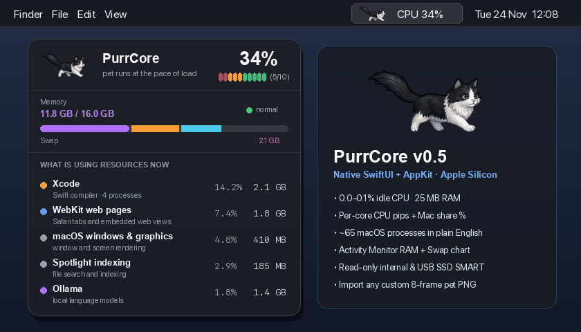
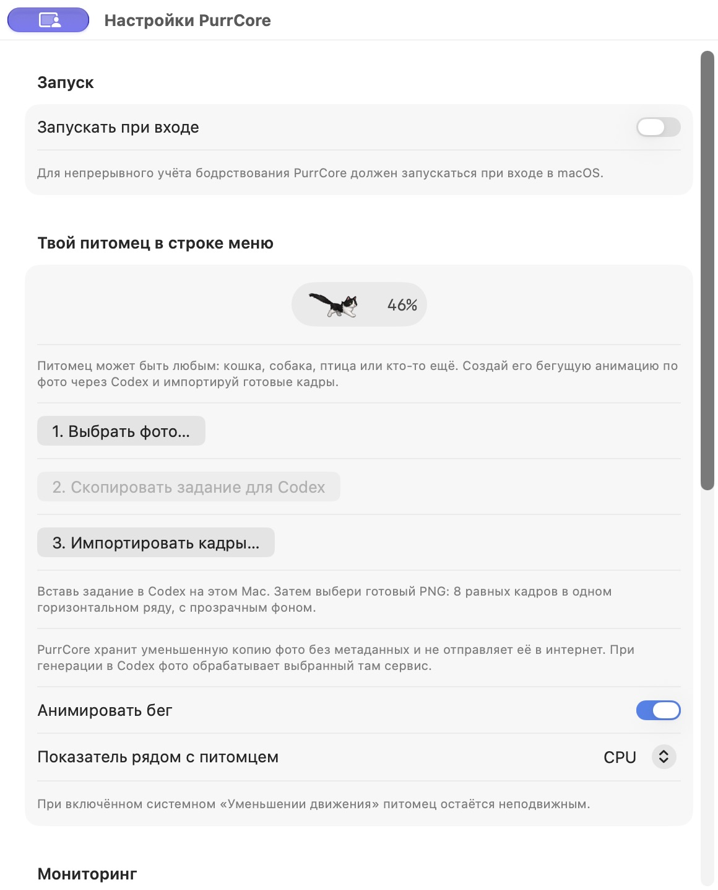

# PurrCore

[](https://github.com/alexandryasukaitisss-cmd/purrcore/actions/workflows/ci.yml)
[](https://github.com/alexandryasukaitisss-cmd/purrcore/releases/latest)
[](LICENSE)

[Русский](README.ru.md) · English

PurrCore is a native macOS menu bar system monitor (**RunCat alternative** for Apple Silicon & macOS 14+): your menu-bar pet runs faster when the CPU is busy, while idle overhead stays at `0.0–0.1% CPU` and `~25 MB RAM`.
Open the popover to see per-core CPU activity, plain-English explanations of ~65 macOS processes, Activity Monitor-aligned RAM/Swap history, awake time, and read-only SSD SMART health.
Your pet can be a cat, dog, bird, or any other animal.





## What it does

- Changes the pet's running speed with CPU load, shows total Mac CPU share (`0–100%`) alongside per-core activity indicators, and lets you display CPU, memory, network, disk, or thermal status in the menu bar.
- Explains ~65 common macOS, WebKit, developer, and AI processes in plain language: `WindowServer` draws windows and screens, `kernel_task` handles drivers, power and temperature, and Spotlight processes search and index files.
- Groups helper processes under their parent app, reports physical memory footprint (`ri_phys_footprint`), and lets you switch between live and historical ("Now / Selected period") rankings.
- Shows kernel memory pressure, Activity Monitor-aligned RAM breakdown, and history charts for CPU, memory, swap, network, and disk over 1 hour, 24 hours, or 7 days.
- Tracks observed awake time, excluding sleep and gaps while PurrCore is closed.
- Tracks battery sessions and estimates full-charge awake time after enough observed discharges.
- Reads available SSD health indicators on demand without continuous background `diskutil` polling. Unsupported readings stay **unknown**, including on external drives.

SwiftUI + AppKit, native system APIs, and SQLite. No separate daemon or third-party runtime packages.
The interface follows the system language: Russian or English. Both READMEs describe the same features.

## Install or build

### Option 1: Homebrew Cask (macOS 14+, Apple Silicon)

```bash
brew install --cask alexandryasukaitisss-cmd/tap/purrcore
```

### Option 2: Download prebuilt archive

Download `PurrCore-0.5.2-macos-arm64.zip` from [GitHub Releases](https://github.com/alexandryasukaitisss-cmd/purrcore/releases/latest), unzip, and move `PurrCore.app` to `/Applications`.

> [!NOTE]
> **First launch on macOS (not Apple-notarized):** Prebuilt releases are ad-hoc signed, so macOS Gatekeeper will show *"Apple could not verify 'PurrCore' is free of malware"* on first launch. To open it once:
> - **Without Terminal:** click **Done** (not *Move to Trash*), open **System Settings → Privacy & Security**, scroll down to **Security**, and click **Open Anyway**.
> - **Or via Terminal:** `xattr -dr com.apple.quarantine /Applications/PurrCore.app`

### Option 3: Build from source

Requires macOS 14+ and a Swift 6 toolchain. Tested on Apple Silicon and Intel CI runners.

```bash
swift test
bash script/build_and_run.sh build
open dist/PurrCore.app
```

The build creates `dist/PurrCore.app` and `dist/purrcorectl` with a local ad-hoc signature.
It is not a notarized release. To keep login-item registration stable, move the app to `/Applications`
and enable launch at login in settings.

## Make your own running pet

1. Open PurrCore settings and choose a photo of **any pet**.
2. Copy the prepared task and paste it into Codex on the same Mac. The task points to a local reference copy.
3. Ask Codex to generate an eight-frame running cycle. Generation depends on the image tool available in Codex.
4. Import the resulting PNG in settings. The new pet runs with CPU load and survives app restarts.

Format: **8 equal cells in one horizontal PNG strip**, preferably 3072×384 pixels with transparent background.
Keep the whole pet inside every cell, at the same scale and baseline. Files must be at most 20 MB.
PurrCore removes shared transparent margins without changing the scale of individual poses.
A badly aligned strip can look uneven; PurrCore cannot check the animal's anatomy.
You can replace the photo or animation, remove the reference photo, or restore the built-in cat.

PurrCore does not generate images or upload photos. It saves a reference copy up to 1024 pixels without
source metadata. If you generate through Codex, the selected image service processes that copy.
Removing the reference photo leaves an already imported animation intact.

## Local data

Data lives in `~/Library/Application Support/PurrCore/`. Each Mac has its own database and pet assets.
There is no telemetry or synchronization. Resource history is retained for seven days.
Completed awake-time sessions and task markers are also cleared after seven days.
Battery sessions are kept indefinitely by default. Settings offer 30, 90 or 365 days for completed discharges, with confirmation before deleting old records. The active discharge is kept. Pet assets remain until you remove them.

The database stores resource aggregates, process group names, and optional task identifiers and labels.
It does not store command lines, window titles, document contents, or task contents.
Do not publish your runtime database or personal reference photos.

SSD indicators depend on macOS and the drive controller. Connection speed and free space do not prove
physical health. PurrCore does not run disk self-tests or repairs.

## Optional command-line tool

```bash
./dist/purrcorectl live
./dist/purrcorectl history --range 24h --points 120
./dist/purrcorectl top --by cpu --range 1h --limit 10
./dist/purrcorectl usage
./dist/purrcorectl ssd
./dist/purrcorectl run --source example --task-id demo --label "Example task" -- your-command
```

`live` prints a JSON snapshot (including per-core load, memory breakdown, swap, and top processes) without opening the history database. `history`, `top`, `usage`, and `ssd` export structured JSON for scripting. `run` records start/end markers and prints a resource summary.
A task runner such as MemPalace can use this interface; it is not an app dependency.

## Inspiration and license

[RunCat](https://github.com/Kyome22/menubar_runcat) and
[RunCatNeo](https://github.com/runcat-dev/RunCatNeo) inspired CPU-driven running and layer-based animation.
[StillCore](https://stillcore.app/) inspired the compact resource-monitor concept.
PurrCore adds readable process groups, local history, awake-time tracking, SSD indicators, and custom pets.

Code and bundled artwork: [Apache License 2.0](LICENSE). See [NOTICE](NOTICE) for attribution.
The built-in cat artwork was generated for PurrCore. Original reference photos are not distributed.
User-imported photos and animations retain their own rights.
